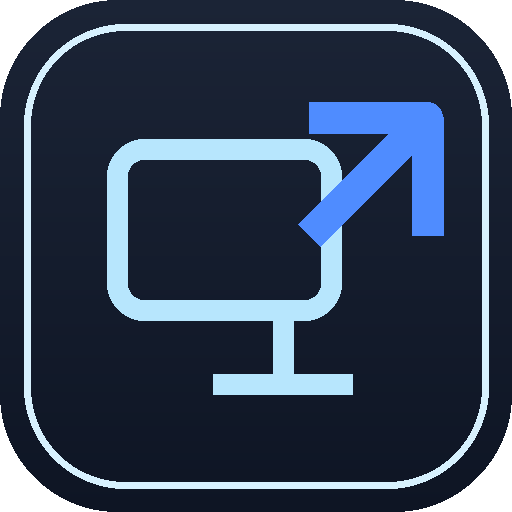

# 在应用中打开（常驻按钮） · dsh-open-in-app-dock



| 项目 | 内容 |
| --- | --- |
| 界面显示名 | **底栏在应用中打开**（`locale/zh.json`） |
| 包名 | `@local/dsh-open-in-app-dock` |
| 版本 | `1.3.0` |
| 形态 | DSH **浏览器侧（Web client）** 插件，宿主半边为空实现 |
| 是否需要皮肤 | 不需要 |
| 是否改 `app.asar` | **不改** |

## 这是什么

DSH 把「在应用中打开」折叠在会话头右上角的 **⋯ 更多菜单** 里，每次都要点两下才能用。

本插件把那份应用列表取出来，做成一个**常驻按钮**：

- 点一下弹出本机已安装的编辑器 / 终端列表（VS Code、Cursor、Windows Terminal、Git Bash…）；
- 选一个，就用它打开**当前会话的工作区目录**；
- 按钮默认显示 **上次用过那个应用** 的图标，与官方控件行为一致。

## 交互模型

| 操作 | 结果 |
| --- | --- |
| **单击按钮** | 立刻用**当前选定的应用**打开当前工作区，不再弹菜单 |
| **右键按钮** | 弹出应用列表，选中即改为「下次单击用它」（不启动） |
| **悬浮后点右下角角标** | 同上；角标平时淡出，悬浮/聚焦/菜单展开时才浮现 |
| **菜单里选应用** | 默认只改记住的应用、不启动；开启设置里的开关后，选中即立刻用它打开 |

按钮图标始终显示「下次单击会用的那个应用」。键鼠两条路径共用同一份占用状态，启动中重复点击会被忽略。

## 三个位置，只在设置里切换

| 位置 | 座位 | 说明 |
| --- | --- | --- |
| **右上角**（默认） | `conversation.session.header.utilities` | 会话标题栏右上，官方 ⋯ 按钮**左边** |
| **底栏左侧** | `conversation.input.left` | 输入框工具栏最左（`+` 号之前） |
| **隐藏** | —— | 两个座位都不渲染，官方 ⋯ 菜单里的原入口不受影响 |

**设置 → 通用 → 「在应用中打开」按钮位置**，三选一的分段控件。按钮自身只负责打开与更换应用，不再承担换位入口。

偏好存在本机浏览器（`localStorage` 的 `dsh-open-in-app-dock:position`），刷新与重启都保留。

## 设置里的两项偏好

**设置 → 通用** 下有两行，都属于本插件：

| 设置项 | 选项 | 存储键 |
| --- | --- | --- |
| **「在应用中打开」按钮位置** | 右上角 / 底栏左侧 / 隐藏 | `dsh-open-in-app-dock:position` |
| **切换打开方式时立即启动** | 开 / 关（默认关） | `dsh-open-in-app-dock:launch-on-pick`（存 `1`/`0`） |

第二项的含义：

- **关**（默认）：右键或角标里选应用，只改「下次单击用哪个」，不打断手头的事；
- **开**：选中另一个应用的同时，立刻用它打开当前工作区——等于「换完顺手打开」。

菜单顶部的提示文案会随该开关变化（「下次单击将用以下应用打开」/「选中后将立刻用该应用打开」），
避免开关状态只能去设置里才能确认。

新增偏好时没有另起一套存储代码，而是把位置偏好抽象成 `createPreference()` 工厂，
两项偏好共用同一份「读取 → 校验 → 落盘 → 通知订阅者」逻辑。

## 为什么能这么放

DSH 的 Web 客户端是槽位（slot）组合系统。三个座位都是 list 且 outlet 是 `display:contents`，所以：

- 组件返回 `null` 时不产生 flex item，**不会留下空隙**；
- 因此可以两个座位都静态注册，只由偏好决定哪个真正渲染，**不需要动态增删注册**；
- 两个座位都注册 `order: -1`，分别排到所在 list 的最前。

右上角座位在源码里的位置（`ConversationSession.tsx`）：

```tsx
<div className={css.headerUtilities}>
  {renderSlot('conversation.session.header.utilities', {})}   // ← 本插件（order -1）
  {renderFactorySlot('contextMenu.button', { /* ⋯ 更多，order 0 */ })}
</div>
```

官方 `ui-schedule` 用 `order:-5` 占同一座位，⋯ 按钮是 order 0，所以本插件取 `order:-1` 落在两者之间。

## 应用列表从哪来

用宿主**已有的三条路由**，与官方 `dsh-client-ui-open-in-app` 完全同一批：

| 方法 | 路径 | 作用 |
| --- | --- | --- |
| `GET` | `open-in-app/apps` | 已探测到的应用 id（宿主张单顺序） |
| `GET` | `open-in-app/icon/<id>` | 该应用的 PNG 图标 |
| `POST` | `open-in-app/open` | `{ app, path }`，由宿主拉起应用打开目录 |

这三条路由自带 connection 信任栅栏（cookie 鉴权 + Host/Origin 校验），浏览器同源 `fetch` 直接可用。
**本插件不新增任何路由，也不碰 `app.asar`**，所以升级 DSH 不会把它冲掉，卸载也不需要还原文件。

## 降级行为

| 情况 | 表现 |
| --- | --- |
| Web 部署 / 宿主没有桌面 | `apps` 返回空 → **完全不渲染按钮**，不留死控件 |
| 当前会话没有工作区（无 `cwd`） | 不渲染 |
| 位置设为「隐藏」 | 两个座位都不渲染，设置行仍在 |
| 应用列表读取失败 | 按钮保留；单击改为展开菜单，给出原因与「重试」 |
| 启动失败（如可执行文件被删） | 按钮短暂变红 3 秒，菜单里给失败提示 |
| 正在启动 | 按钮 `data-busy`，重复点击被忽略；开启「切换时立即启动」也只是多一次受同一个守卫约束的启动 |

菜单按锚点位置自动选择弹出方向：在上半屏（右上角）向下弹，在下半屏（底栏）向上弹，越界时钳制到视口内。

## 与 `dsh-open-in-app-fix` 的关系

两者**互补，不冲突**：

- `dsh-open-in-app-fix` 修的是**宿主侧**「点开就 502」的启动失败（`ELECTRON_RUN_AS_NODE` 污染）；
- 本插件只做**入口**：把已经能用的那份列表挪到更顺手的位置。

建议两个都装。若只装本插件而不装 fix，在本机 Electron-as-Node 环境下点击可能仍然 502。

## 安装

DSH 桌面端 → 左侧栏「插件」→ 安装，填 `.tgz` 的**绝对路径**：

```text
D:\Workspace\Projects\Desktop\deepseek-harness\dsh-open-in-app-dock\build\local-dsh-open-in-app-dock-1.1.0.tgz
```

装完**完全退出并重新启动** DSH（Web 半边要重新走模块装载）。
刷新页面不生效。

## 验证

1. 打开任意有工作区的会话，**右上角 ⋯ 按钮左边**应出现本按钮；
2. 点开应列出本机已装的编辑器与终端，名称与官方「⋯ → 在应用中打开」子菜单一致；
3. 选 VS Code，应打开当前会话的工作区目录；
4. DevTools → Network 中 `POST open-in-app/open` 应为 **200**；
5. 菜单底部「移到底栏左侧」应把按钮移走，且 **设置 → 通用** 里同一偏好同步显示；
6. 无工作区的新会话里按钮应消失。

## 回归测试

```text
node test/smoke.mjs
```

用桩件执行 `client.js`，核对：bundle id、三个座位注册、中英词典键一致、
位置偏好驱动的渲染分支（右上角 / 底栏 / 隐藏）、无工作区不渲染、设置行三选项齐全、

按钮单击与右键事件均已绑定、角标存在且无障碍名为「更换」、按钮自身不再出现换位入口、
两行设置的控件与偏好读写（含「切换时是否顺带启动」的 1/0 持久化与非法值不生效）、
非法偏好回落默认。

不做完整 React 渲染模拟：桩件与真实调度语义容易偏离，会引入假失败；
因此「选中后是否真的启动」用源码契约断言（`remember` 里按 `launchOnPick` 决定是否调用 `start`）兜住。秒级、不触网、不需要 DSH 运行。

## 卸载

插件页移除本插件并重启。槽位贡献随插件卸载自动撤销，**无需还原任何文件**，也不影响 DSH 官方功能。

## 文件说明

| 文件 | 作用 |
| --- | --- |
| `client.js` | **全部逻辑**：位置偏好 → 座位渲染 → 应用目录 → 自绘按钮与 portal 菜单 → 启动路由 |
| `index.js` | 宿主半边空实现（本 bundle 只需浏览器半边） |
| `cordis.patch.yml` | 把本包的 `dsh.client` 入口挂进 Web 插件名册 |
| `locale/zh.json`、`locale/en.json` | 插件页显示名与说明 |
| `icon.svg` / `icon.png` | 插件图标（512×512 PNG 由 SVG 生成） |
| `test/smoke.mjs` | 离线回归测试 |
| `build/*.tgz` | 分发包（`npm pack` 产出，不入库） |

## 版本

| 版本 | 变更 |
| --- | --- |
| `1.3.0` | 新增「切换打开方式时立即启动」偏好（设置 → 通用，默认关）；偏好存储抽象为 `createPreference()` 工厂；菜单提示文案随开关变化 |
| `1.2.0` | 交互改为「单击直接打开」：右键或悬浮角标更换应用；换位入口收进设置（按钮自身不再提供换位菜单） |
| `1.1.0` | 新增位置切换：右上角（默认）/ 底栏左侧 / 隐藏；设置 → 通用 增加偏好行；菜单内可一键换位；冒烟测试覆盖位置分支 |
| `1.0.0` | 首版：`conversation.input.left` 常驻按钮 + 应用列表 portal 菜单 |